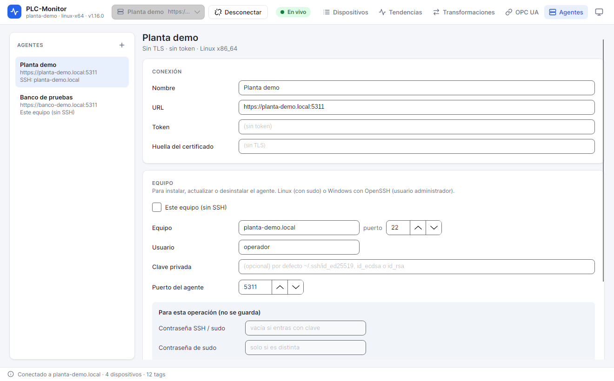

# 3. Agentes y perfiles

Un **agente** es el servicio que habla con los PLC. Un **perfil** es la ficha que guarda la app para saber
cómo llegar a ese agente. Puedes tener varios perfiles y cambiar entre ellos sin cerrar la app.

## 3.1. Qué guarda un perfil

| Campo | Para qué sirve |
|---|---|
| **Nombre** | Etiqueta para reconocerlo en la lista. No tiene que coincidir con el hostname. |
| **URL** | Dirección gRPC del agente, por ejemplo `https://planta-demo.local:5311`. |
| **Token** | Token de acceso completo. Se guarda protegido y se envía en cada llamada. |
| **Huella del certificado** | Huella SHA-256 del certificado TLS del agente. Evita aceptar un certificado cambiado. |
| **Equipo / Puerto SSH** | Host y puerto para instalar o actualizar el agente en remoto. |
| **Usuario SSH** | Usuario con el que se entra al equipo. |
| **Clave privada** | Ruta a la clave SSH. Si está vacía, se puede usar contraseña. |
| **Puerto del agente** | Puerto que se usará al instalar el agente (`5311` por defecto). |
| **Este equipo (sin SSH)** | Instala y gestiona el agente en el mismo equipo donde corre la app. |
| **Plataforma / Instalado** | Datos que rellena la app tras una instalación correcta. |

La app guarda los perfiles en `agents.json`, junto a `app.json`. En Windows el token se protege con DPAPI;
en Linux queda en un fichero con permisos `600`, sin cifrar. En ambos casos, cualquier proceso que se
ejecute con tu cuenta puede usarlo. Protege tu sesión del sistema.

## 3.2. Crear un perfil

1. Abre **Agentes**.
2. Pulsa **+** en la lista **AGENTES**.
3. Escribe un **Nombre**.
4. Rellena la **URL** si ya conoces la del agente. Si vas a instalarlo desde la app, puedes dejarla vacía:
   se rellena al terminar.
5. Pega el **Token** si el agente ya existe. Si vas a generarlo ahora, déjalo vacío.
6. Pega la **Huella del certificado** si el agente ya usa TLS.
7. Si lo vas a gestionar por SSH, completa **Equipo**, **Usuario** y, si hace falta, **Clave privada**.
8. Pulsa **Guardar**.

El perfil aparece en la lista y en el desplegable de la barra superior.

## 3.3. Conectar y desconectar

1. Selecciona el perfil en la barra superior.
2. Pulsa **Conectar**.
3. Espera a que el estado cambie a **Conectado**. La app carga la lista de dispositivos y el estado del
   agente.
4. Para cerrar la sesión, pulsa **Desconectar**. Esto no detiene el agente ni el histórico.

Si el agente está en el mismo equipo y se ejecuta sin instalar, la URL por defecto es
`http://127.0.0.1:5310`. Esa configuración no tiene TLS y solo debe usarse para pruebas locales. El
instalador crea la configuración segura en `5311`.

## 3.4. Instalar o actualizar el agente

La app puede instalar el agente incluido en la release. El paquete se elige automáticamente según la
plataforma detectada. Si quieres usar otro paquete, indica una **Carpeta del agente** en el formulario.

### Instalación local

1. Marca **Este equipo (sin SSH)**.
2. Elige el **Puerto del agente**.
3. Pulsa **Instalar / actualizar**.
4. Acepta la petición de permisos del sistema.
5. Espera a que termine la actividad. La app muestra el progreso y el resultado.
6. Guarda el perfil si la app no lo ha hecho ya.

### Instalación remota

1. Rellena **Equipo**, **Puerto SSH**, **Usuario** y la clave o contraseña.
2. Pulsa **Instalar / actualizar**.
3. La primera conexión muestra la huella del servidor SSH. Compruébala antes de aceptarla.
4. Si el usuario necesita `sudo`, escribe la contraseña en **Contraseña de sudo**. Si usas la misma que la
   de SSH, puedes dejarla vacía.
5. La app copia el agente, crea el servicio, abre los puertos en el firewall si puede y arranca el servicio.

La contraseña SSH y la de `sudo` se usan solo durante la operación. No se guardan en el perfil.

### Qué conserva una actualización

Al instalar o actualizar se conservan:

- `agent.json` y `agent.key`;
- `agent.settings.json` y `agent.pfx`, salvo que pidas regenerar credenciales;
- la carpeta `history/`;
- la carpeta `opcua/` con los certificados aceptados;
- en Windows, la carpeta `logs/`.

El resto de la carpeta del agente se sustituye por el ejecutable nuevo. Por eso no guardes ficheros
propios dentro de `/opt/plc-monitor/agent` ni de `%ProgramFiles%\PLC-Monitor\agent`.

## 3.5. Renovar credenciales

**Renovar credenciales** genera un token y un certificado nuevos sin reinstalar el ejecutable. El token
anterior deja de valer inmediatamente y la app actualiza el perfil si la operación se hace desde él.

Úsalo cuando:

- sospeches que un token se ha compartido;
- hayas cambiado de personas con acceso;
- quieras rotar credenciales por política;
- hayas restaurado un perfil antiguo y el agente tenga otro token.

Después de renovar, las demás apps o scripts que usen el token anterior dejarán de conectar. Actualiza sus
perfiles.

## 3.6. Token de solo lectura

Al instalar, regenerar o renovar puedes marcar **Crear token de solo lectura**. Se genera un segundo token
que permite:

- leer tags y estados;
- consultar histórico;
- explorar símbolos;
- suscribirse a cambios.

No permite escribir, cambiar configuración, instalar ni desinstalar. Úsalo para pantallas de planta,
personas en formación o integraciones que solo deben consultar.

El token de solo lectura se muestra una sola vez al generarlo. Guárdalo en el gestor de secretos
correspondiente. Si lo pierdes, renueva credenciales.

## 3.7. Estado, logs y desinstalación

En la ficha del agente tienes:

- **Estado**: consulta si el servicio está instalado, activo y desde cuándo.
- **Ver log**: muestra las últimas líneas del servicio. En Linux lee `journalctl`; en Windows, el log de
  fichero si existe.
- **Desinstalar**: detiene y elimina el servicio. Si marcas **Conservar agent.json al desinstalar**, la app
  guarda una copia de la configuración y de `agent.key` antes de borrar la carpeta.

**Precaución**: desinstalar borra la carpeta del agente, incluidos `history/` y `opcua/` si están en las
rutas por defecto. Si quieres conservarlos, copia esas carpetas antes. La opción **Conservar agent.json**
solo guarda `agent.json` y `agent.key`.

## 3.8. Varios agentes

Puedes tener un perfil por planta, línea o equipo de pruebas. La app solo mantiene una conexión activa a la
vez, pero conserva las vistas y paneles de cada agente por separado. Al cambiar de perfil, la lista de
dispositivos y las tendencias se recargan.

Los nombres de las vistas y paneles se guardan asociados al agente. Un panel creado para `Planta demo` no
aparece en otro agente aunque los tags se llamen igual.

## 3.9. Buenas prácticas

- Usa un token distinto por instalación. No copies el mismo token a varias plantas.
- No compartas el token completo con quien solo necesita consultar: crea uno de solo lectura.
- Fija la huella del certificado tras la instalación y revisa si cambia sin motivo.
- No guardes contraseñas SSH en el campo de texto de un perfil. La app no las persiste.
- Mantén el reloj del agente sincronizado. El histórico y las gráficas usan la hora del agente y del PLC.
- Anota la versión instalada en cada equipo. La ficha muestra la plataforma y la fecha de instalación.

## Siguiente paso

Con el agente conectado, el siguiente paso es crear los PLC: [Dispositivos y drivers](04-dispositivos-y-drivers.md).
