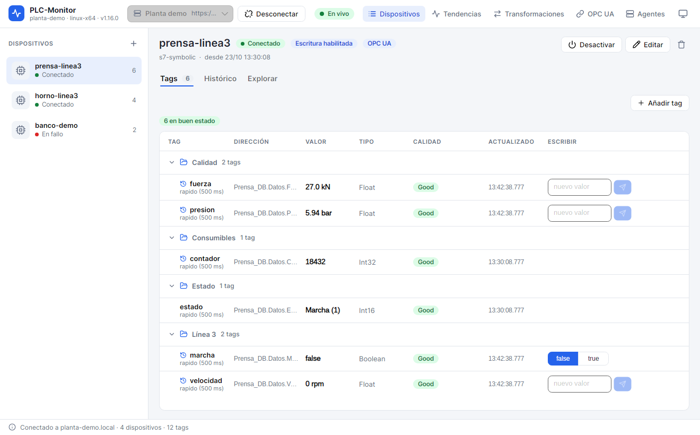
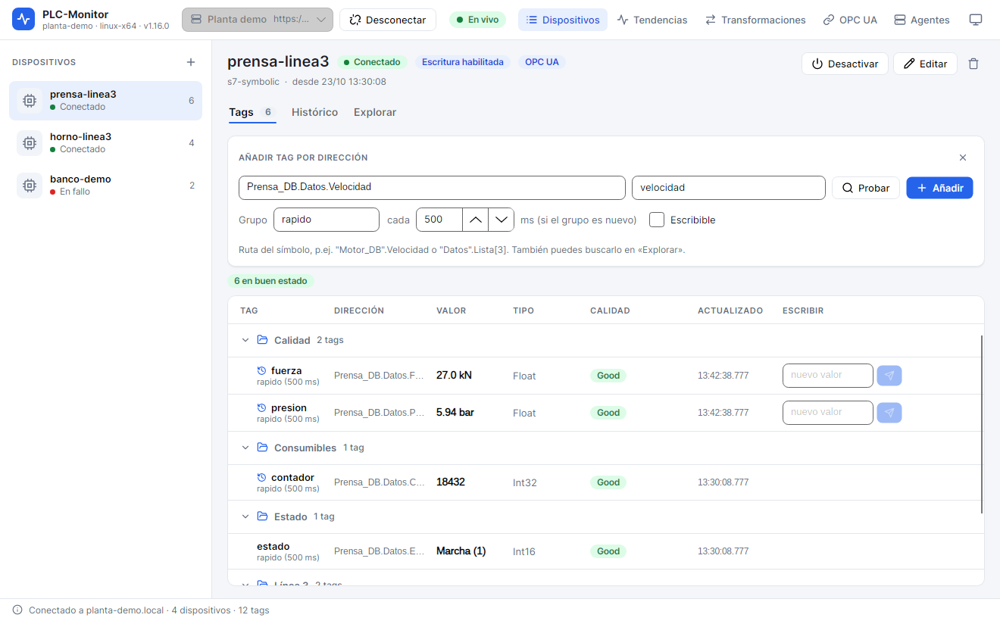
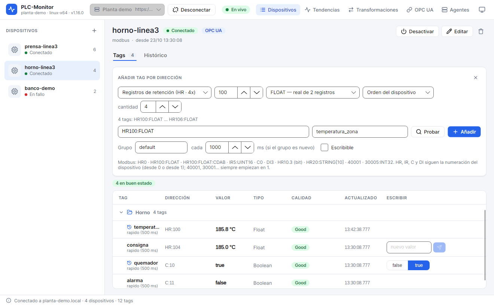
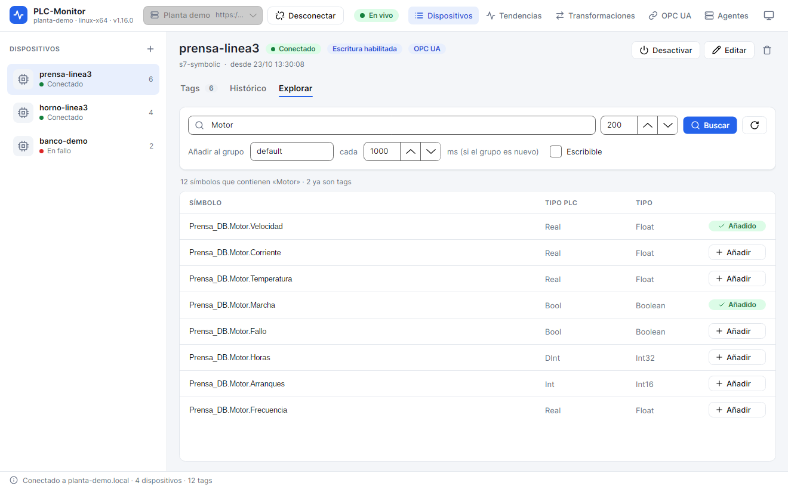
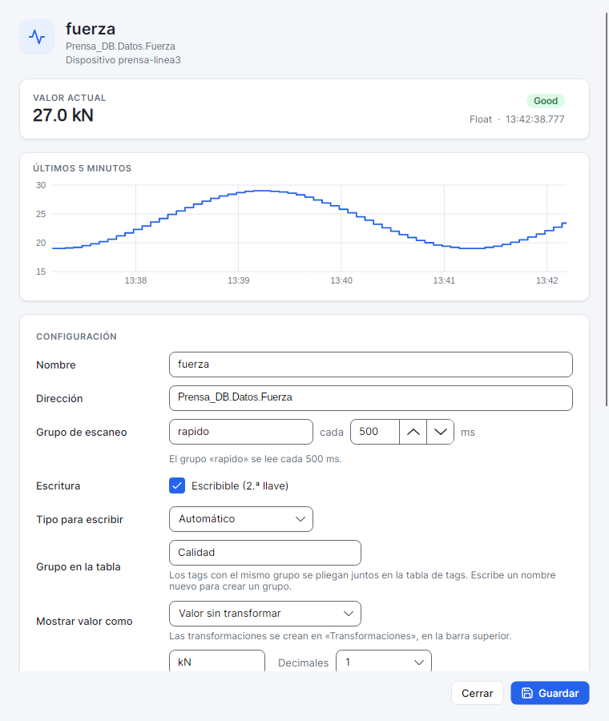

# 5. Tags en vivo

Un **tag** es una variable del PLC con un nombre, una dirección, un tipo y un grupo de escaneo. En la
pestaña **Tags** ves su último valor, la calidad, la hora y, si está permitido, puedes escribir en él.

## 5.1. La tabla de tags

Cada fila muestra:

| Columna | Qué significa |
|---|---|
| **Nombre** | Nombre del tag. Debajo, el grupo de escaneo y su intervalo. |
| **Dirección** | Dirección tal como la entiende el driver. |
| **Valor** | Último valor, con la transformación, los decimales y la unidad configurados. |
| **Tipo** | Tipo detectado por el agente: `Bool`, `Int16`, `Real`, `String`... |
| **Calidad** | `Good`, `Uncertain` o el error (`Bad...`). |
| **Hora** | Hora local de la última actualización. |
| **Escritura** | Campo o botones para escribir, solo si el tag es escribible. |

Los iconos de la cabecera permiten ordenar por nombre, dirección, valor o calidad. Puedes arrastrar la
cabecera de una columna para cambiar el orden y arrastrar tags para reordenarlos o moverlos a un grupo.

Los tags con el mismo **Grupo en la tabla** se pliegan bajo una cabecera. Para crear uno, abre el detalle
del tag y escribe un nombre en **Grupo en la tabla**. El clic derecho sobre un grupo permite renombrarlo o
deshacerlo.

## 5.2. Estados de la tabla

Sobre la tabla aparecen contadores:

- **en buen estado**: tags con calidad `Good`.
- **con error**: tags activos con calidad mala. Si hay alguno, el contador se muestra en rojo.
- **desactivados**: tags que no se leen, no se historizan y no se publican.

Un tag desactivado muestra `—` como valor y `Desactivado` como calidad. No es un fallo: está apartado a
propósito.

## 5.3. Añadir un tag por dirección

1. Selecciona el dispositivo.
2. En **Tags**, pulsa **Añadir tag**.
3. Escribe la **Dirección**.
4. Escribe un **Nombre**. Si lo dejas vacío, se usa la dirección.
5. Indica el **Grupo** y el intervalo en milisegundos. Si el grupo no existe, se crea.
6. Marca **Escribible** si quieres habilitar la segunda llave de escritura.
7. Pulsa **Probar** para leer la dirección sin añadirla.
8. Pulsa **Añadir**.

**Probar** muestra el valor, el tipo y la calidad, o el error. Es útil para distinguir entre una dirección
incorrecta, un PLC desconectado y un problema de permisos. La prueba no crea el tag ni lo historiza.

Si el driver es **Modbus**, el formulario cambia y ofrece desplegables para componer la dirección:

1. Elige la **tabla**: HR (registros de retención), IR (registros de entrada), C (coils) o DI (entradas
   discretas).
2. Escribe el **número** de registro o bit.
3. Elige el **tipo**: INT16, UINT16, INT32, UINT32, FLOAT, DOUBLE, INT64, UINT64, BIT o STRING.
4. Si el tipo ocupa varios registros, indica el **orden de bytes** o deja **Orden del dispositivo**.
5. Para **STRING**, indica cuántos caracteres.
6. Para **BIT**, indica el bit dentro del registro.
7. Si quieres dar de alta varios seguidos, cambia **cantidad**. Se crean hasta 500 tags, cada uno en la
   dirección siguiente.
8. Pulsa **Probar** o **Añadir**.

La dirección compuesta aparece en el campo de texto y se puede editar a mano. Si la editas, se pierde la
vista previa del rango.

### Direcciones admitidas

| Driver | Ejemplos |
|---|---|
| S7 simbólico | `"MiDB".Motor.Velocidad`, `"Datos".Lista[3]` |
| S7 absoluto | `DB1.DBX0.3`, `DB1.DBW10`, `DB1.DINT12`, `DB1.REAL20`, `DB5.STRING30[20]`, `M10.1`, `MW20`, `IW64`, `QX4.0` |
| Modbus | `HR0`, `HR100:FLOAT`, `HR100:FLOAT:CDAB`, `IR5:UINT16`, `C0`, `DI3`, `HR10.3`, `HR20:STRING[10]`, `40001`, `30005:INT32` |

En S7 absoluto, los bloques de datos deben ser **no optimizados**. En S7 simbólico, el nombre debe existir
en el programa y ser accesible desde HMI.

## 5.4. Explorar símbolos (S7 simbólico)

En el driver `s7-symbolic` puedes buscar variables sin conocer su dirección:

1. Selecciona el dispositivo.
2. Abre la pestaña **Explorar**.
3. Escribe parte del nombre en **Buscar** o deja el campo vacío para ver todos.
4. Ajusta el **máximo de resultados** si la CPU tiene muchos símbolos.
5. Pulsa **Buscar**.
6. Elige el **Grupo** y el intervalo.
7. Marca **Escribible** si procede.
8. Pulsa **Añadir** en la fila del símbolo.

La tabla muestra el **símbolo**, el **tipo PLC**, el **tipo** convertido y un botón **Añadir**. Si el
símbolo ya es un tag, aparece **Añadido**. **Refresh** vuelve a leer la lista después de cargar un programa
nuevo en la CPU.

El explorador solo existe en S7 simbólico. En S7 absoluto y Modbus debes escribir la dirección.

## 5.5. Detalle del tag

Haz doble clic en un tag para abrir su detalle.

La parte superior muestra:

- el nombre, la dirección y el dispositivo;
- el **valor actual** con la unidad y, si hay escalado, el valor bruto entre paréntesis;
- la calidad, el tipo y la hora;
- una **mini tendencia de los últimos 5 minutos** con los valores que ha recibido la app.

En **Configuración** puedes cambiar:

| Campo | Efecto |
|---|---|
| **Nombre** | Nombre visible y clave del tag en el histórico. |
| **Dirección** | Dirección en el driver. Se valida al guardar. |
| **Grupo de escaneo** | Grupo y periodo. Cambiar el intervalo afecta a todos los tags del grupo. |
| **Escribible (2.ª llave)** | Habilita la escritura en este tag. Necesita la primera llave del dispositivo. |
| **Tipo para escribir** | Tipo usado al convertir el texto que escribes. **Automático** usa el tipo leído. |
| **Grupo en la tabla** | Carpeta visual para plegar varios tags. |
| **Mostrar valor como** | Transformación de entero a texto. |
| **Unidad** | Texto que se añade al valor (`bar`, `°C`, `rpm`...). |
| **Decimales** | Decimales de los reales. **Todos** muestra el valor completo. |
| **Escalado** | Convierte un valor bruto a unidades de ingeniería. |
| **Publicar en OPC UA (2.ª llave)** | Publica este tag si el dispositivo también está publicado. |
| **Activo** | Si se desmarca, el tag deja de leerse. |

### Escalado

El escalado se aplica en el agente antes de historizar y de publicar. Sirve para convertir, por ejemplo,
`0..27648` en `0..100 %` o `0..10000` en `0..10 bar`.

1. Marca **Convertir el valor bruto a unidades de ingeniería**.
2. Escribe el **Bruto de** y **a**.
3. Escribe la **Ingeniería de** y **a**.
4. Marca **Limitar al rango de ingeniería** si quieres recortar los valores fuera de rango.
5. Revisa la vista previa.

La app muestra el valor convertido y, en el detalle, el bruto entre paréntesis. Las tendencias y el
histórico usan el valor convertido.

### Histórico del tag

En la sección **HISTÓRICO**:

- **Guardar este tag en el histórico**: activa la recogida de muestras.
- **Frecuencia mínima**: milisegundos entre muestras. `0` guarda cada cambio.
- **Banda muerta**: margen que debe cambiar el valor para guardar otra muestra. Puede ser un valor absoluto
  o un porcentaje del último valor.
- **Tiempo máximo**: guarda una muestra aunque no cambie el valor, para dejar constancia de que el tag sigue
  vivo. `0` desactiva esta garantía.
- **Solo mientras otro tag cumpla una condición (disparo)**: historiza solo durante los tramos en que se
  cumple la condición, más un tiempo extra.

Si el historiador del agente está desactivado, la configuración se guarda pero no se registra nada. La app
lo avisa en la ventana.

## 5.6. Escribir en el PLC

Para escribir necesitas:

1. **Escrituras habilitadas (1.ª llave)** en el dispositivo.
2. **Escribible (2.ª llave)** en el tag.
3. Un token de acceso completo. El token de solo lectura no puede escribir.
4. Que el tag esté activo y con calidad buena o incierta.

En la tabla:

- Los tags numéricos muestran un campo **nuevo valor** y un botón de enviar.
- Los booleanos muestran dos botones, **false** y **true**. El valor actual aparece encendido; el otro
  escribe el cambio.

Antes de escribir, la app pide confirmación y muestra el valor actual. Si la escritura falla, el mensaje
indica la calidad o el error devuelto por el agente. Cada escritura queda registrada en la auditoría del
agente.

**Precaución**: una escritura puede mover una máquina. Comprueba la dirección, el tipo y el valor antes de
confirmar. No escribas en tags de seguridad, enclavamientos o consignas críticas sin el procedimiento de la
planta.

## 5.7. Activar, desactivar y quitar

- Clic derecho en un tag > **Editar…** abre su detalle.
- **Abrir su histórico** salta a la pestaña Histórico con ese tag seleccionado.
- **Activar tag** o **Desactivar tag** cambia el estado sin borrar la configuración.
- **Quitar tag…** elimina el tag del dispositivo. El histórico ya guardado no se borra.
- Con varios tags seleccionados (Ctrl o Mayús), las acciones se aplican al conjunto.

**Desactivar** es la opción recomendada para apartar un tag temporalmente. **Quitar** es definitivo en la
configuración, aunque puedes volver a crearlo con la misma dirección.

## 5.8. Buenos nombres y buenos grupos

- Usa nombres estables: el histórico y OPC UA los usan como clave. Cambiar el nombre de un tag historizado
  puede separar las series antiguas de las nuevas.
- Evita `/` en el nombre del tag: se usa como separador en el histórico y en OPC UA.
- Agrupa los tags por máquina o por función con **Grupo en la tabla**. La lista se hace más fácil de leer.
- No pongas todos los tags en el mismo grupo de escaneo si tienen necesidades distintas. Un grupo de 100 ms
  para todo genera tráfico innecesario.
- Para tags que solo cambian de vez en cuando, sube el intervalo y usa **Tiempo máximo** si quieres dejar
  constancia periódica.

## Siguiente paso

Para guardar y consultar valores en el tiempo, sigue con [Histórico](06-historico.md).
