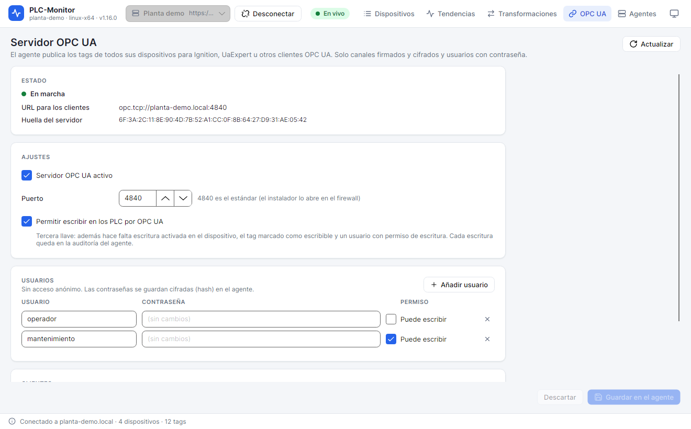

# 10. OPC UA

El agente puede publicar sus tags por OPC UA para que otros sistemas los lean: Ignition, UaExpert, un
historiador, un MES o cualquier cliente OPC UA. El servidor se configura desde la pestaña **OPC UA** y
funciona en el agente, no en la app.



## 10.1. Activar el servidor

1. Conecta con el agente.
2. Abre **OPC UA**.
3. Marca **Servidor OPC UA activo**.
4. Revisa el **Puerto**. El estándar es `4840`; el instalador lo abre en el firewall si puede.
5. Deja **Permitir escribir en los PLC por OPC UA** desmarcado hasta que lo necesites.
6. Añade al menos un usuario.
7. Pulsa **Guardar en el agente**.

La cabecera **ESTADO** muestra:

- **En marcha**, **Arrancando**, **Parado** o **Error**;
- el detalle del error, si lo hay;
- la **URL para los clientes**, por ejemplo `opc.tcp://planta-demo.local:4840`;
- la **huella del servidor**, que el cliente pedirá aceptar.

El servidor no admite acceso anónimo. Sin un usuario con contraseña, un cliente no puede conectar.

## 10.2. Qué se publica

Para que un tag aparezca en OPC UA deben cumplirse dos llaves:

1. **Publicar en OPC UA (1.ª llave)** en el dispositivo.
2. **Publicar en OPC UA (2.ª llave)** en el tag. Está activada por defecto.

Un dispositivo o un tag desactivado no se publica. Si cambias una llave, el árbol de OPC UA se actualiza sin
reiniciar el agente.

### Árbol de nodos

```text
Objects
└── PLC-Monitor
    ├── prensa-linea3
    │   ├── _Estado
    │   │   ├── Conectado
    │   │   ├── Estado
    │   │   ├── Detalle
    │   │   ├── Activo
    │   │   └── EscrituraPermitida
    │   ├── Velocidad
    │   ├── Fuerza
    │   └── ...
    └── horno-linea3
        └── ...
```

- La carpeta `PLC-Monitor` es la raíz del servidor.
- Cada dispositivo es una carpeta con su nombre.
- `_Estado` contiene variables de diagnóstico del dispositivo: conexión, estado, detalle, activo y permiso
  de escritura.
- Los tags se publican con su nombre. Si el tag tiene **Grupo en la tabla**, se crean carpetas anidadas con
  ese nombre.
- El `NodeId` de un tag es `dispositivo/tag` dentro del espacio de nombres de PLC-Monitor. El nombre para
  mostrar y el `BrowseName` es el nombre del tag.

Los tags con calidad mala se publican con valor nulo y un `StatusCode` malo. Los tags con escalado publican
el valor de ingeniería, no el bruto. Las transformaciones no cambian el valor publicado: el cliente recibe
el número.

## 10.3. Usuarios y permisos

En **USUARIOS**:

1. Pulsa **Añadir usuario**.
2. Escribe el **Usuario**.
3. Escribe la **Contraseña**.
4. Marca **Puede escribir** si el usuario debe poder escribir en los PLC.
5. Pulsa **Guardar en el agente**.

- **Sin permiso de escritura**: el usuario puede leer, explorar, suscribirse y leer el histórico. No puede
  escribir.
- **Puede escribir**: además puede escribir, pero solo si se cumplen las tres llaves.
- No hay acceso anónimo.
- Las contraseñas se guardan como hash PBKDF2 en `agent.json`. No se pueden recuperar; si se pierden, hay
  que escribir una nueva.
- El usuario existente muestra la contraseña como puntos suspensivos. Si no escribes una nueva, se conserva
  la actual.

Para cambiar una contraseña, escribe la nueva en el campo correspondiente. Para quitar un usuario, pulsa la
papelera y guarda.

## 10.4. Certificados de clientes

El servidor usa un certificado propio y solo acepta clientes cuyo certificado esté en la lista de
confianza. La primera vez que un cliente conecta, su certificado queda **pendiente** en **CLIENTES**.

1. Conecta desde el cliente a la URL del servidor.
2. En la app, pulsa **Actualizar** o espera a que la pestaña se actualice sola.
3. Localiza el certificado pendiente.
4. Comprueba la **huella** con el cliente o con quien lo administre.
5. Pulsa **Aceptar**.
6. El cliente puede volver a conectar.

Para rechazar un cliente, pulsa la papelera. El cliente dejará de poder conectar. Si vuelve a intentarlo,
aparecerá otra vez como pendiente.

**Precaución**: no aceptes un certificado sin comprobar la huella. Un certificado aceptado puede leer los
tags y, si el usuario tiene permiso, escribir en el PLC.

El certificado del servidor se muestra en la cabecera. El cliente pedirá confiar en él la primera vez.
Compara la huella antes de aceptar.

## 10.5. Leer y explorar desde un cliente

1. Crea una conexión a `opc.tcp://<equipo>:4840`.
2. Elige un canal firmado y cifrado.
3. Acepta el certificado del servidor tras comprobar la huella.
4. Inicia sesión con un usuario y contraseña.
5. Explora `Objects > PLC-Monitor > <dispositivo>`.
6. Lee o suscribe los tags que necesites.

La URL que muestra la app usa el nombre del equipo del agente. Si el cliente no resuelve ese nombre, usa la
dirección que corresponda, pero ten en cuenta que el certificado se ha emitido para el nombre del servidor:
una dirección distinta puede provocar un error de validación. Lo más estable es usar el mismo nombre de
equipo o una entrada DNS local.

Los tags historizados exponen lectura de histórico (`HistoryRead`) si el historiador está activo. Los tags
no historizados solo tienen el valor actual.

## 10.6. Escribir por OPC UA

Escribir por OPC UA requiere **tres llaves**:

1. **Permitir escribir en los PLC por OPC UA** en el servidor OPC UA.
2. **Escrituras habilitadas (1.ª llave)** en el dispositivo.
3. **Escribible (2.ª llave)** en el tag.

Además, el usuario debe tener **Puede escribir**. Si falta una llave, el nodo se publica como solo
lectura y el cliente recibe un error de acceso.

La variable `EscrituraPermitida` de `_Estado` indica si el dispositivo y el servidor permiten escribir; no
tiene en cuenta el permiso del usuario ni la llave del tag.

Cada escritura queda en la auditoría del agente con el usuario de OPC UA y el valor. El agente valida el
tipo y el rango antes de enviarlo al PLC. Si el PLC rechaza la escritura, el cliente recibe un error.

**Precaución**: habilitar la escritura por OPC UA amplía la superficie de riesgo. Actívala solo si un
sistema externo debe escribir consignas, usa usuarios distintos para lectura y escritura, y revisa la
auditoría.

## 10.7. Parar o cambiar el puerto

- Si desmarcas **Servidor OPC UA activo** y guardas, el servidor se detiene y libera el puerto.
- Si cambias el puerto, el servidor se reinicia en el nuevo puerto.
- Si el puerto está ocupado, el estado pasa a **Error** y el detalle indica el motivo.
- Al desinstalar el agente se borra la carpeta `opcua/`, incluidos los certificados aceptados. Si quieres
  conservarlos, copia esa carpeta antes; al reinstalar, los clientes que ya confiaban pueden seguir
  conectando si restauras la misma PKI y el certificado del servidor sigue siendo válido.

El servidor OPC UA no arranca si el agente no está en marcha. Si la pestaña muestra **Parado** y el servidor
debería estar activo, revisa primero el estado del agente.

## 10.8. Buenas prácticas

- Usa un usuario de lectura para los clientes de supervisión y uno de escritura solo para el sistema que
  realmente escribe.
- No reutilices la contraseña de OPC UA para SSH, la app o el PLC.
- Revisa la lista de clientes aceptados y elimina los que ya no se usen.
- Documenta la huella del certificado del servidor y la de cada cliente.
- No publiques el puerto `4840` en Internet. Usa VPN o una red industrial segmentada.
- Si un cliente no ve un tag, comprueba las dos llaves de publicación antes de tocar el certificado.
- Si un cliente conecta pero no puede leer, revisa el usuario, la contraseña y el estado del dispositivo.

## Siguiente paso

Para administrar el agente desde la terminal o integrarlo en scripts, sigue con [CLI](11-cli.md).
