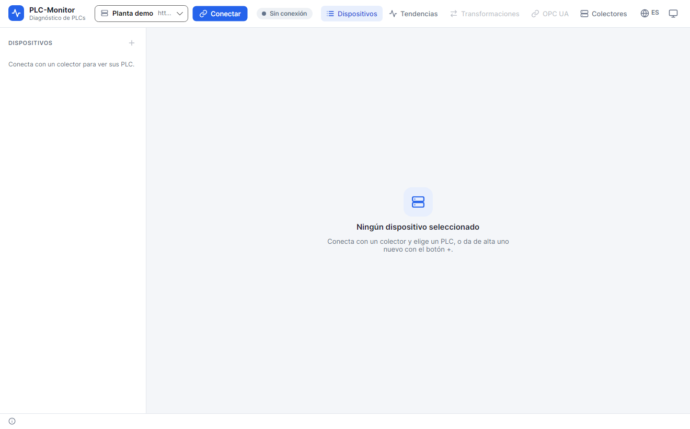

# 2. Installation and first use

This chapter takes you from the downloaded file to a PLC reading values on the screen. If you already have
a collector installed and only want to add a device, you can go directly to the
[Devices and drivers](04-devices-and-drivers.md) chapter.

## 2.1. Run the app

The release is published as a single executable per platform:

```text
artifacts/release/2.0.0/
├── plcmon-app-2.0.0-win-x64.exe
├── plcmon-app-2.0.0-linux-x64
└── plcmon-app-2.0.0-linux-arm64
```

The executable is self-contained: it includes the .NET runtime and the native libraries. You do not need to
install .NET or copy additional folders.

### Windows

1. Copy the `.exe` to a local folder, for example `C:\Herramientas\PLC-Monitor`.
2. Run it with a double-click.
3. If Windows SmartScreen shows a notice because it is an executable without a commercial signature, review
   the source and choose to run it anyway only if you trust the file.

### Linux

1. Copy the binary to a folder of your user.
2. Give it execute permission:

   ```bash
   chmod +x plcmon-app-2.0.0-linux-x64
   ```

3. Run it from the terminal or from the file browser:

   ```bash
   ./plcmon-app-2.0.0-linux-x64
   ```

The app saves its preferences in the user data folder:

- Linux: `~/.config/PLC-Monitor/` (it follows the system's `ApplicationData` convention).
- Windows: `%APPDATA%\PLC-Monitor\`.

There you will find `app.json`, `agents.json`, `trends.json`, and `panels.json`. Do not edit them while the
app is open.

## 2.2. First startup

When you open the app with no collector configured, you will see the main window with the **Sin conexión**
(Not connected) status.



The top bar has three areas:

- **Perfil de colector** (Collector profile): the drop-down with the known collectors. The first time it may be empty
  or have a local profile.
- **Conectar / Desconectar**: changes depending on the status.
- **Tabs**: **Dispositivos**, **Tendencias**, **Transformaciones**, **OPC UA**, and **Colectores**.

You do not need to connect to create a profile, but you do need to connect to read or configure a collector.

## 2.3. Install the collector

The collector is an independent service. The app can install it on this same computer or on another one over
SSH. The installation creates a token, a TLS certificate, and the system service.

### On this computer

1. Open the **Colectores** tab.
2. Click **+** to create a profile.
3. Type a **Nombre** (Name), for example `Planta demo`.
4. Check the **Este equipo (sin SSH)** checkbox; it means this computer, without SSH.
5. Leave the **Puerto del colector** (Collector port) at `5311` unless it is already in use.
6. Click **Instalar / actualizar** (Install / update). The system will ask for administrator permissions
   (`sudo`, `pkexec`, or UAC).
7. When it finishes, the app fills in the **URL**, the **Token**, and the **Huella del certificado**
   (Certificate thumbprint). Click **Guardar** (Save).
8. Select the profile in the top bar and click **Conectar** (Connect).

The local installation copies the collector bundled with the app, creates the service user, and registers the
service. You do not need to download anything else.

### On another computer over SSH

1. Create a new profile in **Colectores**.
2. Type the **Nombre** and the **Puerto del colector**.
3. In **Equipo** (Computer), type the host or IP of the PLC computer and the SSH port (usually `22`).
4. Type the SSH **Usuario** (User).
5. Specify a **Clave privada** (Private key) or leave the field empty to use the password.
6. Click **Instalar / actualizar**.
7. The first time, the SSH server thumbprint is shown. Verify it with whoever administers the computer and
   accept it. The app pins it in the profile.
8. If needed, enter the SSH password and the `sudo` password for that operation. They are not saved.
9. When it finishes, save the profile and connect.

The remote installation requires the computer to have SSH, `bash` or PowerShell, and administrator
permissions. On Linux, the systemd service `plcmon-agent` is created; on Windows, the `PLCMonitorAgent`
service.

### Paths created by the installer

| Platform | Folder | Service |
|---|---|---|
| Linux | `/opt/plc-monitor/agent` | `plcmon-agent` |
| Windows | `%ProgramFiles%\PLC-Monitor\agent` | `PLCMonitorAgent` |

Inside the collector folder:

- `plcmon-agent` or `plcmon-agent.exe`: the executable.
- `agent.json`: devices, tags, transformations, and historian.
- `agent.settings.json`: port, token hash, and TLS certificate.
- `agent.pfx`: server certificate and key.
- `agent.key`: key used to protect the saved passwords.
- `history/`: SQLite history files.
- `opcua/`: OPC UA server certificates and configuration.
- `logs/`: logs on Windows and, if configured, on Linux.

Do not copy `agent.key` or `agent.pfx` to a computer other than the collector's. They are secrets.

## 2.4. Connect and check the status

Select the profile and click **Conectar**. The top bar changes to **Conectado** (Connected) and shows the
collector name, the platform, and the version. The device list is populated with whatever the collector has
configured.

If the connection fails:

- check that the service is active;
- check that the URL ends in the correct port (`5311` with TLS);
- confirm that the token is the collector's and not that of another profile;
- review the certificate thumbprint if the collector was reinstalled;
- check the firewall between the app and the collector.

The [Troubleshooting](14-troubleshooting.md) chapter has a more complete list.

## 2.5. Create the first device

1. **Dispositivos** tab.
2. Click **+** in **DISPOSITIVOS**.
3. Type a **Nombre** without `/`, for example `prensa-linea3`.
4. Choose the **Driver**.
5. Fill in the driver settings. For S7 symbolic you need at least the PLC host or IP; for Modbus, the host
   and the port; for S7 absolute, the host and the CPU.
6. Leave **Activo** (Active) checked.
7. Click **Guardar**.

The device appears in the list with the **Conectando** (Connecting) status and then **Conectado** or
**En fallo** (Failed). The failure detail is shown under the name and in the device header.

If you do not know the address, in the symbolic driver you can use **Explorar** (Browse) to search for
symbols. In the other drivers you will have to type the tag address.

## 2.6. Add a tag and view it live

1. Select the device.
2. In the **Tags** tab, click **Añadir tag** (Add tag).
3. Type the **Dirección** (Address). In the symbolic driver it can be a name, for example
   `"MiDB".Motor.Velocidad`.
4. Type a **Nombre** or leave the field empty to use the address.
5. Choose the **Grupo** (Group) and the interval. If the group does not exist, it is created.
6. Click **Probar** (Test) to read the address without adding it. It is the fastest way to detect a
   misspelled address.
7. Click **Añadir** (Add).

The tag appears in the table with its value, type, quality, and update time. If the quality is `Bad`, check
the address, the type, and the device status.

You can also use **Explorar** in the symbolic driver to see the CPU symbols and add them with a button. It is
the recommended way when you do not know the exact name.

## 2.7. Tour the tabs

- **Dispositivos**: live tags, history, and browser for the selected PLC.
- **Tendencias**: saved charts and panels. They can be created without having a device selected.
- **Transformaciones**: tables of integer values to text.
- **OPC UA**: status and configuration of the collector's OPC UA server.
- **Colectores**: profiles, installation, credentials, status, and logs.

The theme button in the top bar switches between light and dark. The preference is saved in `app.json`.

## 2.8. Close the app and the collector

Closing the app does not stop the collector or the history. If you want to stop reading a PLC, disable the
device or the tag. If you want to stop the collector service:

```bash
# Linux
sudo systemctl stop plcmon-agent

# Windows (PowerShell as administrator)
Stop-Service PLCMonitorAgent
```

To start it again, use `start` instead of `stop` or `Start-Service` in PowerShell.

**Caution**: do not stop the service while you are writing a setpoint or right after a change, unless it is
necessary. The historian flushes its data to disk when it closes, but a forced stop can leave the last
samples unsaved.

## Next step

With a collector and a device connected, the next chapter explains how to manage several profiles, install
remotely, and renew credentials: [Collectors and profiles](03-collectors-and-profiles.md).
