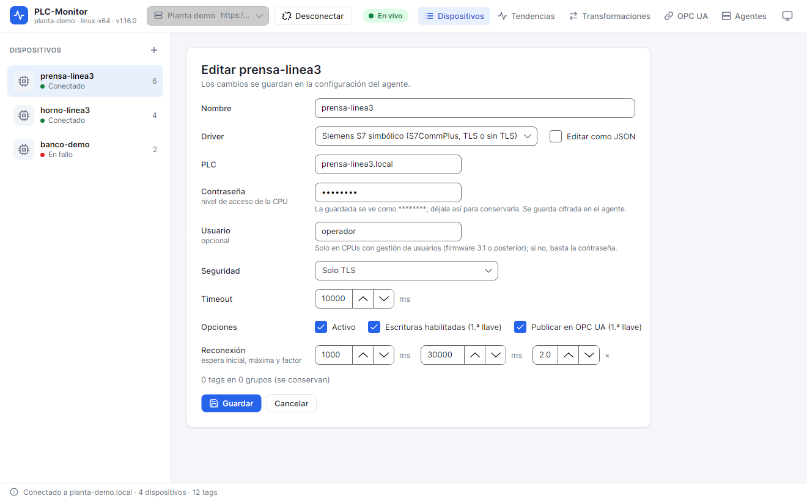
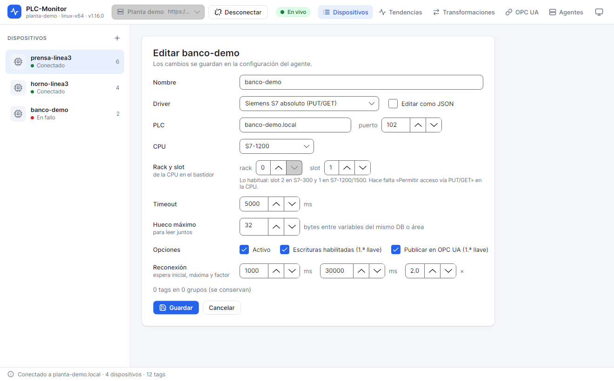
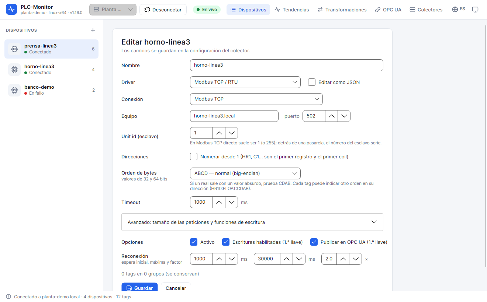
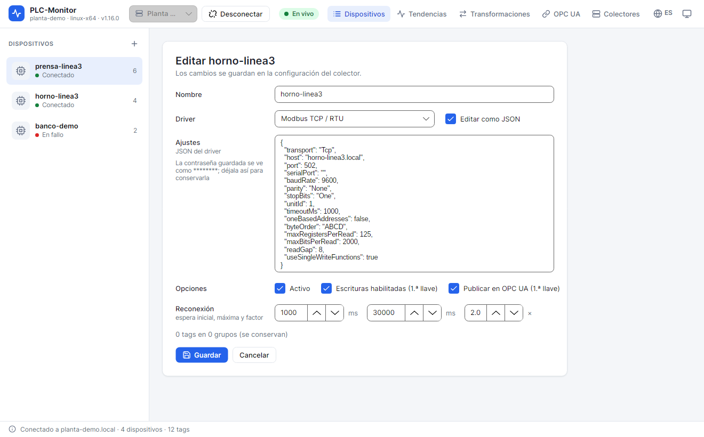

# 4. Devices and drivers

A **device** represents a PLC, drive or gateway inside the agent. Each device has a
driver, connection settings and its own tags. The tags of a device share the connection and are
organized into scan groups.

## 4.1. Create a device

1. Connect to the agent.
2. Open **Dispositivos** (Devices).
3. Click **+** in the **DISPOSITIVOS** (DEVICES) list.
4. Enter a **Nombre** (Name). It cannot contain `/`, because that character separates the device from the tag in
   history and in OPC UA. Examples: `prensa-linea3`, `horno-linea3`, `banco-demo`.
5. Choose the **Driver**. Changing the driver loads its default settings.
6. Fill in the driver settings.
7. Review the **Opciones** (Options):
   - **Activo** (Active): if it is unchecked, the device is configured but does not connect.
   - **Escrituras habilitadas (1.ª llave)** (Writes enabled, first key): allows writing to its tags. Without this key, no tag of the
     device can be written.
   - **Publicar en OPC UA (1.ª llave)** (Publish to OPC UA, first key): publishes the device on the OPC UA server. The tags also need
     their second key.
8. Adjust **Reconexión** (Reconnection) if the PLC takes a long time to start or the network is unstable.
9. Click **Guardar** (Save).

The device appears in the list. The status can be **Conectado** (Connected), **Conectando** (Connecting), **En fallo** (Failed) or
**Desconectado** (Disconnected). The header shows the driver, how long it has been in that state and the failure
details.

## 4.2. Device options

### Activo

A device with **Activo** (Active) unchecked does not connect, does not read tags, does not record to history and does not publish to OPC UA. It is useful to
prepare a machine that is not yet on the network or to set aside a faulty PLC without deleting its configuration.

### Escrituras habilitadas

**Escrituras habilitadas** (Writes enabled) is the first of the three write keys. The second is in the tag (**Escribible**, Writable) and the third, if
the write comes through OPC UA, in the server (**Permitir escribir en los PLC por OPC UA**, Allow writing to PLCs over OPC UA) and in the OPC UA
user. All three must be active. Writes are recorded in the agent audit.

### Publicar en OPC UA

**Publicar en OPC UA** (Publish to OPC UA) is the first publishing key. If it is disabled, the device does not appear on the OPC UA server
even if its tags have the second key. When you enable it, the tags with **Publicar en OPC UA** appear in the
server tree.

### Reconexión

With **Reconexión** (Reconnection), the agent retries the connection with an exponential wait:

- **espera inicial** (initial wait): time before the first retry;
- **espera máxima** (maximum wait): growth limit;
- **factor**: multiplier for each retry.

The default values are `1000 ms`, `30000 ms` and `2`. If the PLC starts very slowly, raise the maximum
wait; if the network is fast and you want to recover sooner, lower the initial one.

## 4.3. S7 symbolic driver

The `s7-symbolic` driver uses S7CommPlus to read variables by name. It is the recommended option on
S7-1200 and S7-1500 when the program has accessible symbols.

| Field | What it indicates |
|---|---|
| **PLC** | IP or name of the PLC. |
| **Contraseña** (Password) | Password of the CPU access level. If the CPU is not protected, leave it empty. |
| **Usuario** (User) | Only for CPUs with user management (firmware 3.1 or later). Otherwise, classic password authentication is used. |
| **Seguridad** (Security) | **Automática (TLS si la CPU lo admite)** (automatic, TLS if the CPU supports it), **Solo TLS** (TLS only) or **Sin TLS (TIA Portal V16 o anterior)** (no TLS, TIA Portal V16 or earlier). |
| **Timeout** | Maximum time of an operation, in milliseconds. |

Notes:

- The saved password is shown as `********`. If you leave that value, the existing one is kept. If
  you type another one, it is replaced.
- **Automática** tries TLS and, if the CPU rejects it, uses classic authentication. This is the usual case.
- **Solo TLS** requires a CPU with secure PG/HMI communication. If the CPU does not support it, the connection fails.
- **Sin TLS** is for old projects or CPUs with secure communication disabled. Do not use it on an
  untrusted network.
- The password is stored encrypted in the agent with `agent.key`.

With this driver you can use **Explorar** (Browse) to search for symbols. Addresses are program paths, for
example `"MiDB".Motor.Velocidad` or `"Datos".Lista[3]`.

## 4.4. S7 absolute driver

The `s7-absolute` driver uses PUT/GET and absolute addresses. It works for S7-300/400 and also for
S7-1200/1500 when PUT/GET access is enabled.

| Field | What it indicates |
|---|---|
| **PLC** | IP or name of the PLC. |
| **puerto** (port) | TCP port. Usually `102`. |
| **CPU** | S7-1500, S7-1200, S7-300 or S7-400. When you change it, the usual slot is suggested. |
| **rack** | Rack number. Usually `0`. |
| **slot** | CPU slot: `2` on S7-300 and `1` on S7-1200/1500. |
| **Timeout** | Maximum time of an operation. |
| **Hueco máximo** (Maximum gap) | Separation in bytes tolerated to read several variables in the same request. |

Requirements on the PLC:

- PUT/GET access must be allowed on the CPU;
- the data blocks you want to read must be **non-optimized**;
- addresses must be absolute: `DB1.DBX0.3`, `DB1.DBW10`, `DB1.DINT12`, `DB1.REAL20`, `M10.1`,
  `MW20`, `IW64`, `QX4.0`.

This driver does not browse symbols. Create tags by typing the address.

## 4.5. Modbus driver

The `modbus` driver supports three transports:

- **Modbus TCP**: direct connection to the device over Ethernet, port `502` by default.
- **Modbus RTU**: serial port of the computer where the agent runs (`COM3`, `/dev/ttyUSB0`...).
- **Modbus RTU over TCP**: RTU frames inside a TCP connection, for serial-to-Ethernet converters in
  transparent mode.

| Field | What it indicates |
|---|---|
| **Conexión** (Connection) | TCP, RTU or RTU over TCP. |
| **Equipo / puerto** (Host / port) | Host and TCP port. Not used in RTU. |
| **Puerto serie** (Serial port) | Port on the agent computer. RTU only. |
| **Línea serie** (Serial line) | Baud rate, parity and stop bits. They must match the device. |
| **Unit id (esclavo)** (Slave unit ID) | Slave number. In direct TCP it is usually `1` or `255`; behind a gateway, that of the serial slave. |
| **Direcciones** (Addresses) | Check **Numerar desde 1** (Number from 1) if the device manual counts `HR1` as the first register. Addresses `40001`, `30001`... always start at 1. |
| **Orden de bytes** (Byte order) | ABCD, CDAB, BADC or DCBA for 32- and 64-bit values and text. |
| **Timeout** | Maximum time of an operation. |
| **Avanzado** (Advanced) | Request size, gap between tags and write functions. |

Byte order is the most frequent cause of a `FLOAT` with an absurd value. If the value makes no
sense, try `CDAB`. You can also specify the order in the tag address itself:
`HR100:FLOAT:CDAB`.

In RTU, the service user needs access to the serial port. The installer adds the `plcmon` user to
`dialout` or `uucp` if the group exists. If the port does not appear, type the path manually.

## 4.6. Edit settings as JSON

The **Editar como JSON** (Edit as JSON) button shows the same settings in the `agent.json` format. It is useful to copy
the configuration to another device, paste a prepared block or adjust a field that is not in the
form.

**Caution**: the JSON must be valid. If you save incorrect JSON, the agent will reject the change and the
app will show the error. The saved password is shown as `********`; leave it that way to keep it.

## 4.7. Activate, deactivate and remove

- **Desactivar** (Deactivate) leaves the device in the configuration but disconnects it. It is reversible.
- **Editar** (Edit) changes the name, driver, settings and options. Tags are kept.
- **Eliminar** (Remove) removes the device and its tags from the configuration. History already saved is not deleted
  automatically; to clear it, use **Borrar datos** (Delete data) on the **Histórico** (History) tab or the CLI.

If you rename a device with recorded tags, the app offers to move the history to the
new name. Accept the move if you want to keep the samples; otherwise, they will remain associated with the old
name.

## 4.8. Check the connection

When you save a device, the agent tries to connect. Check:

1. The status in the list and in the header.
2. The detail under the name: unreachable host, timeout, authentication error, etc.
3. The **Tags** tab: if the tags have `Bad` quality, the problem may be an address, type or
   permissions issue, not only the connection.
4. **Explorar** in S7 symbolic: if it browses but does not read a tag, the connection is fine and the problem is in
   the address.
5. The agent log in **Agentes > Ver log**.

## Next step

With the device connected, create and review its variables: [Live tags](05-live-tags.md).
