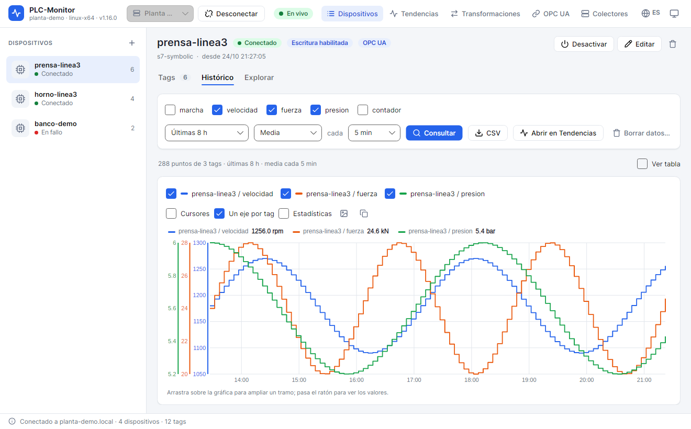
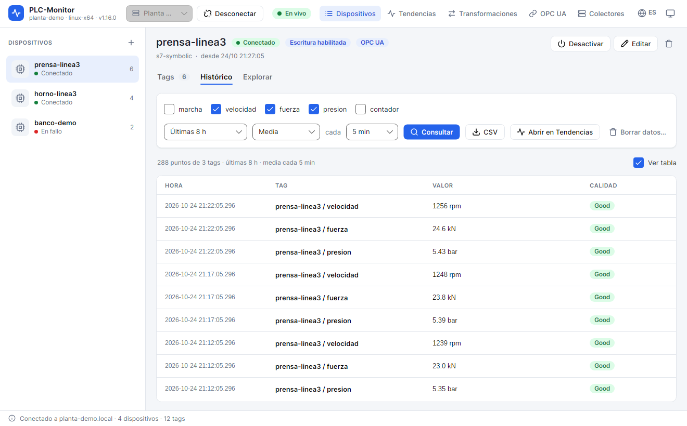

# 6. History

The history stores tag samples on the collector's disk so you can answer questions such as "what pressure was
there when it failed?" or "how much has the counter increased during the shift?". The app does not need to
be open: the collector continues recording to history even if you close the window or the network disconnects.

## 6.1. Enable history recording

History recording is configured per tag, in its details:

1. Double-click the tag.
2. Scroll down to **HISTÓRICO** (History).
3. Check **Guardar este tag en el histórico** (Save this tag to history).
4. Adjust the **Frecuencia mínima** (minimum interval), the **Banda muerta** (deadband), and the
   **Tiempo máximo** (maximum time).
5. Click **Guardar** (Save).

The first time a tag is recorded to history, the collector starts saving from that moment. It does not recover
earlier values that were not saved.

### Minimum interval

This is the minimum time between two samples. `0` means "save every change". If a tag changes very quickly,
a frequency of `1000` ms prevents filling the disk with thousands of points per minute.

### Deadband

A sample is saved only if the value has changed by more than the deadband. It can be:

- an absolute value, for example `0.5` for a pressure in bar;
- a percentage of the last saved value, for example `1` for 1%.

The deadband applies to numeric values. A quality change is always saved, even if the value does not
change.

### Maximum time

If the value does not change, the collector saves a sample at regular intervals. This serves to prove that the
tag was still communicating even though its value was constant. `0` disables this guarantee.

### Trigger

The trigger allows saving only while another tag meets a condition. For example, save the pressure only
while `Marcha` is `true`, or the temperature only when `Estado` is greater than `2`.

1. Check **Solo mientras otro tag cumpla una condición (disparo)** (Only while another tag meets a condition (trigger)).
2. Choose the **Tag de disparo** (Trigger tag).
3. If it is Boolean, choose **true** or **false**. Otherwise, choose the condition (`=`, `≠`, `>`, `≥`, `<`, `≤`) and
   enter the **valor** (value).
4. Specify **Y después** (And after) how many milliseconds it continues saving after the condition stops being met.
5. Save.

When the condition is met, the current value is saved and, while it lasts, the frequency, the deadband, and
the maximum time are applied. At the end, a final point is saved. Quality changes are always saved.

### Collector historian

The historian can be disabled globally in `agent.json` (`historian.enabled`). If it is disabled, the tag
configuration is saved but nothing is recorded. The details window warns about it.

## 6.2. Query history

1. Select the device.
2. Open the **Histórico** (History) tab.
3. Check the tags you want to see. Only tags with history recording enabled appear.
4. Choose the **periodo** (period): últimos 15 min (last 15 min), última hora (last hour),
   últimas 8 h (last 8 h), 24 h, 7 días (7 days), or 30 días (30 days).
5. Choose the aggregate:
   - **En bruto** (Raw): every saved sample;
   - **Media** (Average), **Mínimo** (Minimum), **Máximo** (Maximum), **Primero** (First), or **Último** (Last): one value per interval.
6. If you have chosen an aggregate, choose the **intervalo** (interval): 1 s, 10 s, 1 min, 5 min, 15 min, 1 h, or 1 día (1 day).
7. Click **Consultar** (Query).

The result is shown as a chart and, if you check **Ver tabla** (View table), also as a table.



The chart has one series per tag. You can:

- hover to see values and times;
- drag to zoom;
- use **Ajustar** (Fit) to remove the zoom;
- enable **Un eje Y por tag** (One Y axis per tag) if the scales are very different;
- open **Estadísticas** (Statistics) to see the minimum, maximum, average, standard deviation, first, last,
  delta, samples, and rising edges of each tag;
- export the chart to PNG or copy it to the clipboard.

The summary indicates how many points have been received, from how many tags, the period, and the
aggregate. If **hay más puntos: usa un agregado o un periodo más corto** (there are more points: use an
aggregate or a shorter period) appears, the query has been truncated. The collector limits the result to 20,000
points per query.

### Raw vs. aggregate

- **En bruto** (Raw) preserves gaps and quality changes. It is best for viewing a short event.
- **Aggregate** reduces the number of points. **Media** smooths noise; **Mínimo** and **Máximo** highlight
  peaks; **Primero** and **Último** are useful to see the state at the beginning or end of each interval.

A shorter aggregate interval gives more detail, but also more points. If the query is truncated, increase
the interval or reduce the period.

## 6.3. The table



The table shows one row per point and tag, sorted from newest to oldest:

| Column | Content |
|---|---|
| **Hora** (Time) | Local time with milliseconds. |
| **Tag** | Tag name. |
| **Valor** (Value) | Numeric or text value. In the table, the tag's decimals and unit are applied. |
| **Calidad** (Quality) | `Good`, `Uncertain`, or the error. |

The table is useful for locating an exact value and for copying data. The exported CSV preserves the full
value, not only the rounded value shown in the table.

## 6.4. Export to CSV

1. Run a query.
2. Click **CSV**.
3. Choose where to save the file.
4. The app confirms how many rows it has written.

The file has this header:

```text
device,tag,timestamp,value,quality,unit
```

- `device`: device name.
- `tag`: tag name.
- `timestamp`: UTC time in ISO 8601 format, for example `2026-10-23T08:15:30.000Z`.
- `value`: full value. Texts with commas or quotes are escaped according to RFC 4180.
- `quality`: quality of the point.
- `unit`: unit configured in the tag.

Old CSV files without the `unit` column can also be read. The separator is the comma and the encoding is
UTF-8 without BOM.

The CSV can be opened in a spreadsheet or loaded again in **Tendencias > Datos > Fichero CSV exportado**
(Trends > Data > Exported CSV file). It is a way to preserve a data capture or share it without giving
access to the collector.

## 6.5. Open in Trends

The **Abrir en Tendencias** (Open in Trends) button creates a view with the checked tags and the chosen
period, with data read from history, and opens it. From there you can change the chart type:

- tendencia (trend);
- ciclos superpuestos (overlaid cycles);
- X-Y;
- cronograma de estados (state timeline);
- histograma con Cp/Cpk (histogram with Cp/Cpk);
- barras por periodo (bars by period).

The view is saved in the trends list. The [Trends and charts](07-trends-and-charts.md) chapter explains
each type.

## 6.6. Delete data

1. Check the tags.
2. Click **Borrar datos…** (Delete data…).
3. Choose the start and end date and time. The fields are filled with the period you were
   querying.
4. Click **Borrar** (Delete) and confirm.

Deleting removes the samples of those tags in that interval. It cannot be undone. If the collector is old and
does not support the operation, the app will ask you to update it from **Colectores > Instalar / actualizar**
(Collectors > Install / update).

**Caution**: before deleting, export the interval to CSV if it may be needed for an investigation.
Deleting does not affect the tag's configuration or its future history recording.

## 6.7. Where it is stored

The collector stores history in SQLite, in the `history/` folder of its installation. It creates one file per
month:

```text
history-2026-10.db
history-2026-11.db
```

Retention is configured in `agent.json`:

```json
"historian": {
  "enabled": true,
  "path": "history",
  "retentionDays": 30,
  "flushIntervalMs": 5000
}
```

- `retentionDays`: days the files are kept. `0` disables automatic deletion.
- `flushIntervalMs`: how often samples are flushed to disk.

Configuration and backup details are in
[Configuration and maintenance](13-configuration-and-maintenance.md).

## 6.8. Best practices

- Record to history only the tags you need. Each tag recorded to history consumes disk and CPU.
- Use a minimum interval and a deadband consistent with the dynamics of the signal.
- For a specific event, enable the trigger instead of saving all day.
- Review retention before you need old data. If the policy is 30 days, you will not be able to query
  a failure from three months ago.
- Export to CSV the periods you must keep outside the collector.
- Synchronize the clock of the collector and the PLC. An incorrect time makes data appear in the wrong
  period.

## Next step

To turn this data into saved charts and panels, continue with
[Trends and charts](07-trends-and-charts.md).
