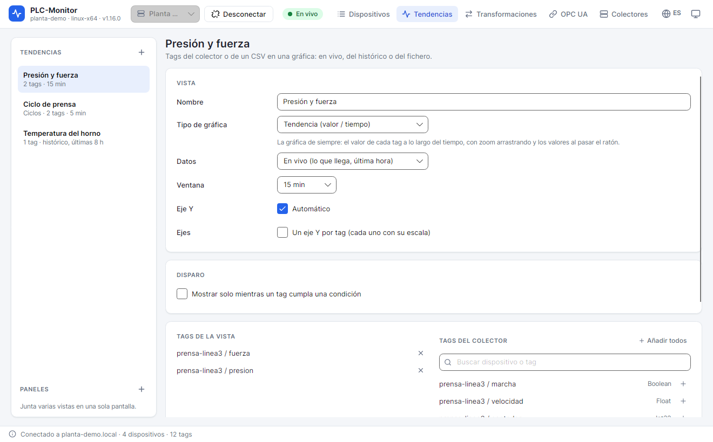
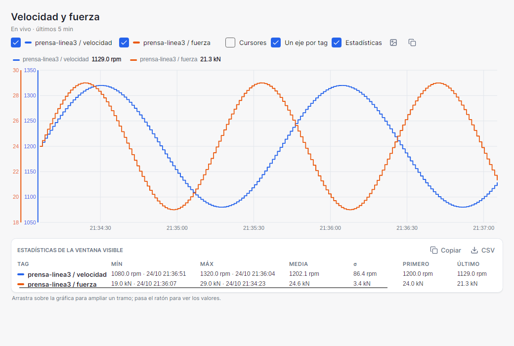
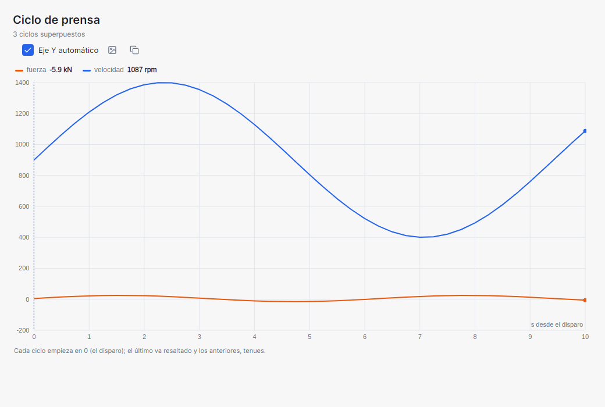
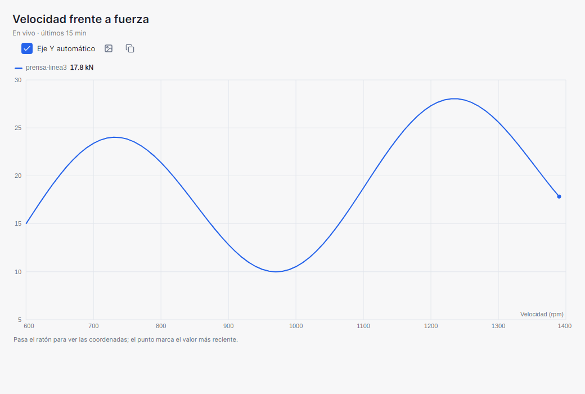
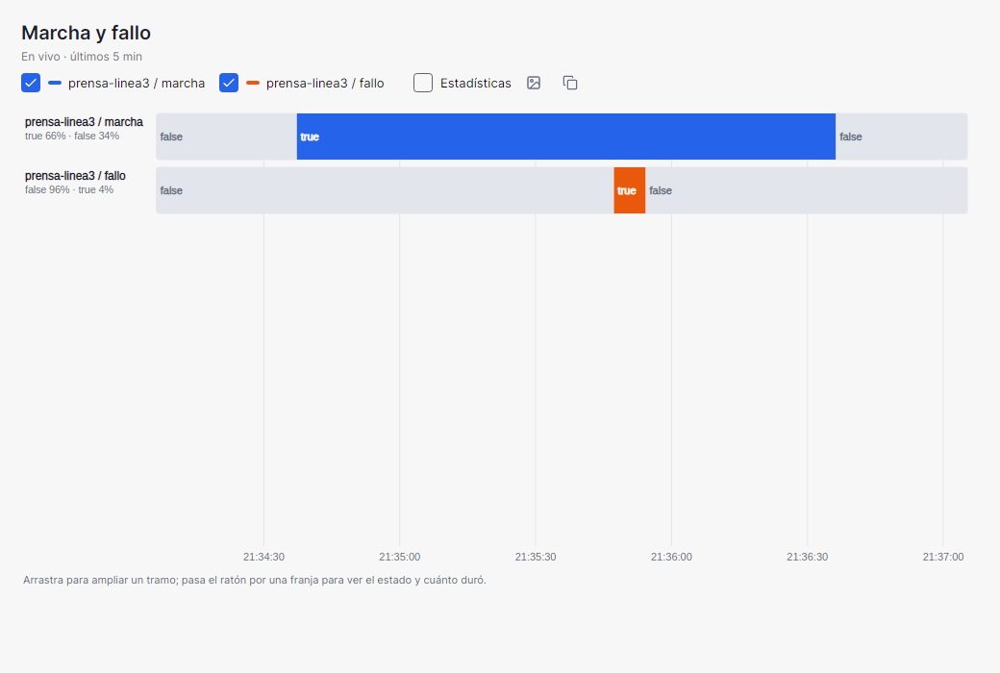
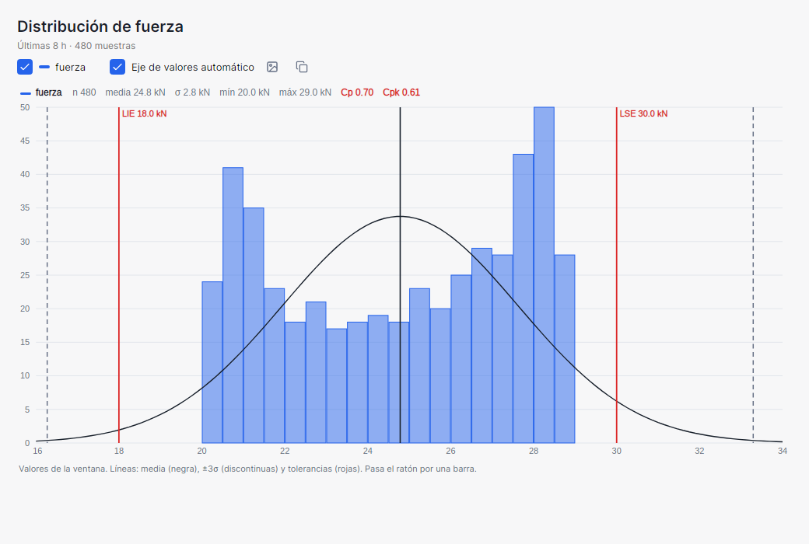
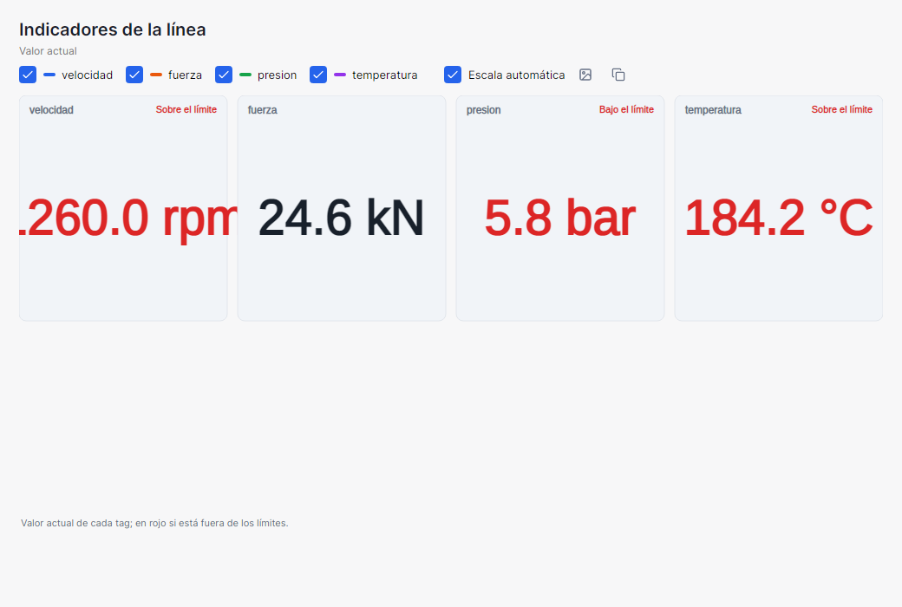
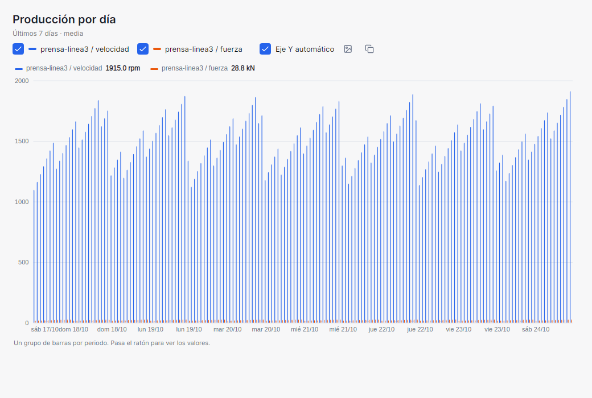

# 7. Trends and charts

A **trend view** is a saved chart: it has a name, one or more tags, a chart type, and a data source. It is
created once and opened when needed. You do not need to select a device to open a view.

## 7.1. Create a view

1. Open **Tendencias** (Trends).
2. Click **+** in **TENDENCIAS**.
3. Enter a **Nombre** (Name).
4. Choose the **Tipo de gráfica** (Chart type).
5. Choose the **Datos** (Data): en vivo (live), histórico del colector (collector history), or fichero CSV (CSV file).
6. Adjust the options for the type: window, period, limits, bars, etc.
7. Add tags from the list on the right. You can search by device or tag and use **Añadir todos** (Add all).
8. Configure the **Disparo** (Trigger) if you want to see only certain ranges.
9. Adjust the **Eje Y** (Y axis) or check **Un eje Y por tag** (One Y axis per tag).
10. Click **Guardar** (Save) to keep the view or **Abrir** (Open) to view it.

The list on the left has two sections:

- **PANELES** (Panels): grids with several views. They are explained in [Panels](08-panels.md).
- **TENDENCIAS** (Trends): saved views of this collector and CSV views, which can be opened offline.

Views are saved in `trends.json`, in the app's data folder. Panels are saved in `panels.json`, next to that
file.

## 7.2. Data sources

| Source | What it shows | Requirements |
|---|---|---|
| **En vivo (lo que llega, última hora)** (Live data, last hour) | The values the app has received since it was opened. | Collector connected. |
| **Histórico del colector** (Collector history) | The values saved by the collector in the chosen period. | Tags with history recording enabled. |
| **Fichero CSV exportado** (Exported CSV file) | The values from a history CSV file. | None; it can be viewed offline. |

The **En vivo** (Live) source does not query history. If you open the app and create the view, you start
seeing data from that moment. The app keeps up to one hour of values per tag in memory, so a view opened
after a while can show the last minutes, but not anything from before the app was opened.

The **Histórico** (History) source queries the collector when the view is opened. The window is fixed: the data
does not change while you look at it. The **Actualizar** (Refresh) button queries again. If a tag is not
recorded to history, it appears in the notice of missing tags.

The **CSV** source reads a file exported from the History tab. Its tags are the ones in the file, not the
collector's. Text tags are ignored; bad qualities leave a gap.

## 7.3. The live chart

When you open a live view:

- The window advances with the clock. You can choose **1 min**, **5 min**, **15 min**, or **1 h**.
- **Pausa** (Pause) freezes the view; **Seguir** (Resume) returns to the current window.
- When you zoom, the view pauses automatically. **Ajustar** (Fit) removes the zoom and continues.
- The legend lets you check and uncheck tags.
- **Un eje Y por tag** gives each tag its own scale. It is useful when you compare a speed in rpm with a
  force in kN.
- The **cursores** (cursors) button shows two cursors, A and B, to measure the time between two instants
  and how much each tag changes.
- **Estadísticas** (Statistics) shows the minimum, maximum, time-weighted average, standard deviation,
  first, last, delta, number of samples, and rising edges of each tag in the visible window. They can be
  copied or saved to CSV.
- **PNG** exports the chart with title, period, and legend on a white background. The copy button puts it
  on the clipboard.

The header shows the history period or the live window, how many points there are, and when it was queried.
If the collector has truncated the response, it says so.

## 7.4. Chart types

### Trend

It is the chart of value versus time. Each tag is drawn as a line or step. Booleans are drawn as steps
between 0 and 1.

Use it to:

- see the evolution of a signal;
- compare several signals;
- locate a peak or a gap;
- measure times with the cursors.

### Overlaid cycles

Every time the trigger is met, a cycle starting at 0 is drawn. Cycles are overlaid like the persistence of
an oscilloscope: the last one is highlighted and the previous ones remain faint.

- It requires a trigger. Without it, the app will not let you open the view.
- At most, the 20 most recent cycles are drawn.
- The X axis is the time since the trigger, in seconds.
- **Fijar último ciclo como referencia** (Set last cycle as reference) saves the last cycle of each tag and
  draws a tolerance band. Cycles that fall outside the band are shown in red.
- The **Tolerancia ±** (Tolerance ±) can be a tag value or a percentage of the reference range.

It is used to compare machine cycles and detect the cycle that deviates from normal.

### X-Y

It draws one tag against another instead of against time. The **first tag in the view is the X axis** and
the others are the Y axis. With the **Eje X** (X axis) button you can move a tag to the first position.

It requires at least two tags. Examples: force versus position in a press, pressure versus flow, torque
versus speed.

With a trigger, one curve is drawn per cycle. Without a trigger, the complete curve for the window is
drawn.

### State timeline

It shows a strip per tag, with a color per state. When you hover, you see the duration of each segment and
the percentage of time in each state.

It is intended for:

- booleans (run/stop, open/closed, alarm/no alarm);
- state or sequence-step integers.

A value that is not in the transformation is shown with its number. If the tag has a transformation, the
timeline uses the texts.

### Histogram with Cp/Cpk

It shows how the values in the window are distributed:

- bars per class;
- mean and standard deviation;
- minimum and maximum;
- ±3σ lines;
- lower and upper tolerances (LIE/LSE).

If you enter one or both tolerances, it calculates process capability:

- **Cp** = (LSE − LIE) / (6σ), with both tolerances;
- **Cpk** = the smallest distance from the mean to a tolerance / (3σ).

You can use live or history data. With a trigger, the histogram uses only the values of the cycles.

### Panel indicators

It shows the current value of each tag in large format, like an operator panel. There are three styles:

- **Aguja** (Needle);
- **Barra de nivel** (Level bar);
- **Solo el valor** (Value only).

If you configure lower and upper **Límites** (Limits), the indicator turns red when the value goes outside
them. Booleans are shown as a light. Indicators only work live: they represent the current value, not a
historical period.

### Bars by period

It groups history data by **Hora** (Hour), **Turno (8 h)** (Shift (8 h)), or **Día** (Day). For each period
and tag it draws a value:

- **Máximo** (Maximum);
- **Media** (Average);
- **Mínimo** (Minimum);
- **Incremento (contador)** (Increment (counter)): the difference between the last and first value in the period, useful for
  production counters.

Choose the range: **Hoy y ayer** (Today and yesterday), **Últimos 7 días** (Last 7 days), or **Últimos 30 días**
(Last 30 days). If you use shifts, specify the time at which the first shift starts; the other two start 8
and 16 hours later.

Bars are not live: they are queried when the view is opened and updated with **Actualizar** (Refresh). Tags
must be recorded to history; if any is not, the app warns and draws the others.

## 7.5. Trigger

The trigger limits what is shown to the ranges in which another tag meets a condition.

1. Check **Mostrar solo mientras un tag cumpla una condición** (Show only while a tag meets a condition).
2. Choose the **Tag de disparo** (Trigger tag). It can be any tag in the collector, whether or not it is in the view.
3. If it is Boolean, choose **true** or **false**. Otherwise, choose the condition and enter the **valor** (value).
4. Specify **Antes del disparo** (Before the trigger): seconds shown before it is met.
5. Specify **Después** (After): seconds shown after it stops being met.

Outside those ranges the chart is blank. Live, the header shows **Activo** (Active) or **Esperando**
(Waiting). The trigger is calculated from what is received live or from the queried history.

Overlaid cycles require a trigger. The histogram with a trigger uses only the values of the active ranges.
Bars and indicators do not support a trigger.

## 7.6. Y axis and limits

- **Automático** (Automatic): the axis adjusts to the data.
- **mín / máx** (min / max): fixes the scale. Values outside are visually clipped.
- **Un eje Y por tag** (One Y axis per tag): each tag has its own scale and color. In the histogram the
  label changes to **Eje de valores** (Value axis); in the indicators, to **Escala** (Scale).

For the histogram, **Tolerancias** (Tolerances) defines LIE and LSE. For the indicators, **Límites**
(Limits) defines when the value turns red.

## 7.7. Save, open, and delete

- **Guardar** (Save) keeps the changes in `trends.json`. It does not close the open chart.
- **Abrir** (Open) saves and shows the chart.
- **Borrar** (Delete) deletes the view. If the view is in a panel, it is removed from the panel; the panel is not deleted.
- **Editar vista** (Edit view) returns from chart mode to the form.

If you change the name of a tag or remove it from the collector, the view keeps the reference. When you open
it, the app warns that the tag is not available and draws the others. You can edit it to replace it.

## 7.8. CSV views

1. Choose **Fichero CSV exportado** (Exported CSV file) as the source.
2. Click **Elegir CSV…** (Choose CSV…).
3. Select a file exported from history.
4. The tag list is filled with the file's tags.
5. Choose the ones you want and open the view.

CSV views can be opened without being connected to the collector. They are saved in `trends.json` and appear in
the list of all profiles, because they do not depend on a specific collector. The CSV source is not available
for indicators.

## 7.9. Best practices

- Use names that describe the machine and the signal: `Prensa 3 · fuerza y posición` is better than `Tendencia 4`.
- Use **En vivo** to diagnose now and **Histórico** to investigate what has already happened.
- To compare magnitudes with different units, enable **Un eje Y por tag**.
- Do not overload a single view with tags: the legend and the scales become difficult to read.
- If a historical query is slow or truncated, reduce the period or use a type with an aggregate.
- Save a copy of `trends.json` if you have created many views and are going to change computers.

## Next step

To see several charts at once, continue with [Panels](08-panels.md).
