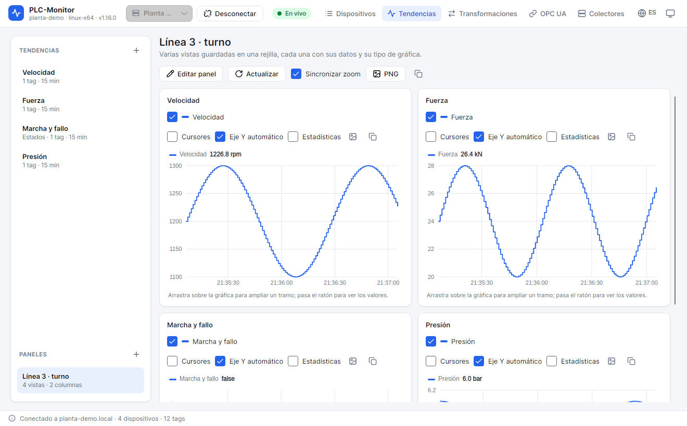

# 8. Panels

A **panel** places several trend views in a grid so you can see them at once. It is useful for an operator
screen, to compare several cycles, or to have a joint view of a machine.

## 8.1. Create a panel

1. Open **Tendencias** (Trends).
2. In **PANELES** (Panels), click **+**.
3. Enter the **Nombre** (Name).
4. Choose the **Columnas** (Columns): from 1 to 4.
5. Check **Sincronizar el zoom de las gráficas de tiempo** (Synchronize the zoom of time charts) if you want
   zooming one chart to zoom the others.
6. Add views from **VISTAS GUARDADAS** (Saved views) with the **+** button.
7. Reorder the views with the up and down arrows. They are placed by rows, in that order.
8. Click **Guardar** (Save) or **Abrir** (Open).

A panel can contain live, history, CSV, and bar views. Views must exist before you add them. A panel does
not create tags or new charts: it reuses the views in **TENDENCIAS**.

## 8.2. The grid

- **Columnas** (Columns): 1, 2, 3, or 4. Rows are created automatically according to the number of views.
- **Orden** (Order): first from left to right and then from top to bottom.
- **Quitar del panel** (Remove from panel): the view stops being shown, but it is not deleted from **TENDENCIAS**.
- **Editar panel** (Edit panel): returns to the form.
- **Abrir** (Open): rebuilds all cells and queries history again.

The open panel has a fixed cell height so the grid is uniform. On small screens vertical scrolling may
appear. Use fewer columns or fewer views so everything fits.

## 8.3. Synchronize zoom

With **Sincronizar zoom** (Synchronize zoom) active, zooming a range on one time chart zooms the same range
on the other time charts in the panel. Synchronization applies to:

- trends;
- state timelines.

It does not apply to X-Y, cycles, histograms, indicators, or bars, because they do not share an absolute
time axis.

You can change synchronization in the form or with the **Sincronizar zoom** checkbox in the bar of the open
panel. The change is saved with the panel.

## 8.4. Live data and historical data

- Live cells update with the clock, just like an open view.
- History cells are queried when the panel is opened and do not change until you click **Actualizar** (Refresh).
- Bar cells are queried when opened and are also updated with **Actualizar**.
- CSV cells are read from the file when opened.

**Actualizar** reads history and bars again, and rebuilds the cells. If you have changed a tag or a view,
this is how to see it reflected in the panel.

If a view fails, its cell shows the error and the others keep working. A panel does not become unusable
because a view has lost its tag.

## 8.5. Export the panel

The panel bar has:

- **PNG**: exports the entire panel, with a white background, titles, and cells.
- **Copiar** (Copy): copies the image to the clipboard.

The PNG is useful for attaching a screenshot to a report or an incident. The image is generated with the
size of the open grid; if you want more detail, enlarge the window before exporting.

## 8.6. Panels and collector profiles

Panels are saved per collector. A panel created with the `Planta demo` profile does not appear when you connect
to another collector, even if the views have the same names. CSV views are the exception: they can be used in
any profile because they do not depend on a collector.

If you connect to another collector and do not see your panels, check the profile selected in the top bar.

## 8.7. Panel examples

### Machine screen

- **Tendencia** (Trend): speed and torque.
- **Cronograma** (Timeline): machine sequence.
- **Indicadores** (Indicators): production, pressure, and temperature.
- **Barras** (Bars): production by shift.

### Cycle diagnostics

- **Ciclos superpuestos** (Overlaid cycles): force and position.
- **X-Y**: force versus position.
- **Histograma** (Histogram): force distribution.
- **Cronograma** (Timeline): cycle states.

### Shift comparison

- **Barras** (Bars) of production by shift.
- **Tendencia** (Trend) of the average shift speed.
- **Histograma** (Histogram) of shift pressure.
- **Indicadores** (Indicators) of the current value.

## 8.8. Best practices

- Do not put more than 6 or 8 views in a panel: beyond that, the charts become small.
- For a fixed screen, use 2 columns and live views.
- For a report, use 1 or 2 columns and historical data, and export to PNG.
- Name the panel by its use (`Línea 3 · turno`), not by number.
- If a view is used in several panels, edit it in **TENDENCIAS**; the change will be visible in all of them when you reopen them.
- Deleting a view removes it from panels, but does not delete the panels.

## Next step

To display integer values as text and assign them to tags, continue with
[Transformations](09-transformations.md).
