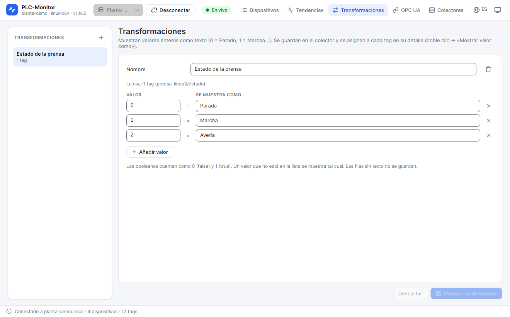

# 9. Transformations

A **transformation** converts an integer value into text. For example:

```text
0 = Parado
1 = Marcha
2 = Avería
```

The transformation is saved in the collector and assigned to a tag. The value that is read, recorded to history, and
published over OPC UA remains the number; what changes is how it is displayed in the app.



## 9.1. Create a transformation

1. Open **Transformaciones** (Transformations).
2. Click **+** under **TRANSFORMACIONES**.
3. Enter the **Nombre** (Name), for example `Estado del motor`.
4. In the **VALOR / SE MUESTRA COMO** (VALUE / DISPLAYED AS) table, enter the number and its text.
5. Click **Añadir valor** (Add value) to create more rows.
6. Click **Guardar en el colector** (Save to collector).

The app creates a new transformation with the values `0` and `1` so you can get started. Changes are not
applied until you click **Guardar en el colector**. If you change your mind, click **Descartar** (Discard).

### Validation rules

- The name cannot be empty or duplicate another transformation, case-insensitively.
- The value must be an integer. Negative values are allowed.
- There cannot be two rows with the same value in one transformation.
- Rows without text are not saved. They are useful to leave a gap while you edit.
- Values are sorted from lowest to highest when saved.

If something does not comply, the app shows the error and does not send the changes to the collector.

## 9.2. Assign a transformation to a tag

1. Double-click the tag.
2. In **Mostrar valor como** (Display value as), choose the transformation.
3. Click **Guardar** (Save).

The **Valor sin transformar** (Untransformed value) option removes the transformation. In the table, the tag shows the text and the
value in parentheses:

```text
Marcha (1)
```

If the value is not in the transformation, the number is shown as is. This lets you add new states
without breaking existing tags.

The transformation is applied only to integer values. A `REAL` or a `STRING` is not transformed. Booleans
count as `0` (`false`) and `1` (`true`), so you can use a transformation to display them as `Parado` and
`Marcha`, or let the app display them as `false` and `true`.

## 9.3. Transformations in use

Each transformation shows how many tags use it:

- **Sin usar** (Unused) if none use it.
- **1 tag** or **N tags**, with the names of the tags.

You cannot delete a transformation in use. The app prevents it and tells you which tags use it. To delete it:

1. Open each tag that uses it.
2. Change **Mostrar valor como** to **Valor sin transformar** or to another transformation.
3. Save the tags.
4. Go back to **Transformaciones** and delete it.

Renaming a transformation in use also updates the tags that use it. When you save a name change, the tags
that used it move to the new name. If the new name collides with another transformation, the app asks you
to save the changes separately.

## 9.4. Edit and delete

- **Select** a transformation in the list to edit it.
- **Añadir valor** creates a row with the next free number.
- The trash icon on a row removes that value.
- The trash icon in the header deletes the entire transformation, if it is not in use.
- **Descartar** reloads the saved version and discards unsaved changes.

Changes are sent all together. If another computer modifies the transformations while you have unsaved
changes, the app does not reload the list so as not to overwrite your edit. When you save, the collector validates the set.

## 9.5. Where it is applied

The transformation affects:

- the **Valor** (Value) column of the tag table;
- the **valor actual** (current value) of the detail window;
- the label shown when you hover over some elements of the app.

It does not change:

- the numeric value sent to the PLC when writing;
- the value saved in history;
- the value published over OPC UA;
- the chart calculations, which use the number.

Therefore, if you need an external system to receive the state text, the transformation is not enough: the
external system must interpret the number or receive another text tag.

## 9.6. Examples

### Machine state

```text
0 = Parado
1 = Marcha
2 = Avería
3 = Emergencia
```

### Sequence step

```text
10 = Inicio
20 = Carga
30 = Prensa
40 = Descarga
50 = Fin
```

### Valve

```text
0 = Cerrada
1 = Abierta
```

### Bool as text

```text
0 = No
1 = Sí
```

## 9.7. Best practices

- Use stable, descriptive names: `Estado del motor` is better than `Transformación 1`.
- Do not reuse the same name for states of different machines.
- Keep the texts short: they are shown in a table and in narrow windows.
- If a new state appears in the PLC, add it to the transformation; values not listed are shown
  as a number and nothing is lost.
- Document the meaning of the values in the name or in the text, not only in an external comment.
- Before deleting a transformation, check the tags that use it in the panel on the right.

## Next step

To publish the tags to other systems, continue with [OPC UA](10-opc-ua.md).
